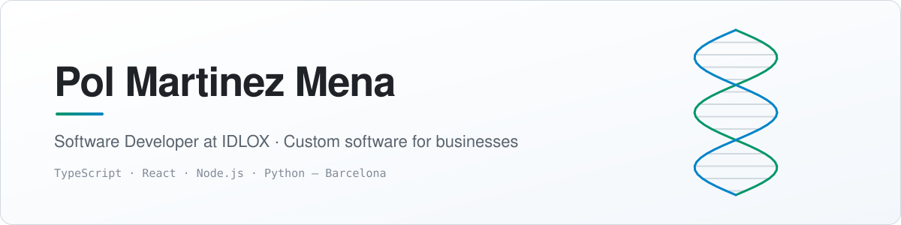

<picture>
  <source media="(prefers-color-scheme: dark)" srcset="assets/banner-dark.svg">
  
</picture>

  
  
  

I'm a **full-stack developer** and **biotechnology student** in Barcelona. I build production web apps for real businesses — booking systems, admin dashboards and offline-first PWAs — and I'm bringing the same engineering habits to **bioinformatics**: reproducible, well-tested tools for working with biological sequence data.

- 🧪 **Studying** Biotechnology, with a focus on computational biology
- 🛠️ **Building** booking and management platforms for healthcare clinics and local businesses
- 🧬 **Exploring** sequence analysis in Python: FASTA parsing, ORF detection, translation and BLAST
- 🗣️ **Languages** Spanish, Catalan, English

## Featured work

<table>
  <tr>
    <td width="50%" valign="top">
      <h3>🧭 <a href="https://github.com/polmartinezmena/rumbo">Rumbo</a></h3>
      
Offline-first GPS navigator for Spain. On-device routing (A* in a Web Worker), Spanish voice guidance, <b>flood-aware safe routes</b>, speed cameras and a one-tap SOS — with no account, no servers and no tracking.

      

        
        
        
      

      <a href="https://polmartinezmena.github.io/rumbo/"><b>▶ Live demo</b></a>
    </td>
    <td width="50%" valign="top">
      <h3>🧬 <a href="https://github.com/polmartinezmena/dna-sequence-analyzer">DNA Sequence Analyzer</a></h3>
      
Python toolkit for DNA sequence analysis: FASTA reading, GC content, translation, open reading frame (ORF) search and BLAST queries.

      

        
        
      

    </td>
  </tr>
  <tr>
    <td colspan="2" valign="top">
      <h3>💼 Client work</h3>
      
Online booking apps and public websites for healthcare practices (psychology, physiotherapy), inventory management for hospitality, and corporate sites — full-stack TypeScript with React, tRPC and MySQL, deployed on Vercel. <i>Private repositories; demos on request.</i>

    </td>
  </tr>
</table>

## Toolbox

**Web** &nbsp;

**Science** &nbsp;

**Tools** &nbsp;

---

Open to freelance projects and bioinformatics collaborations — <a href="mailto:pol.martinez.mena@gmail.com">get in touch</a>.

